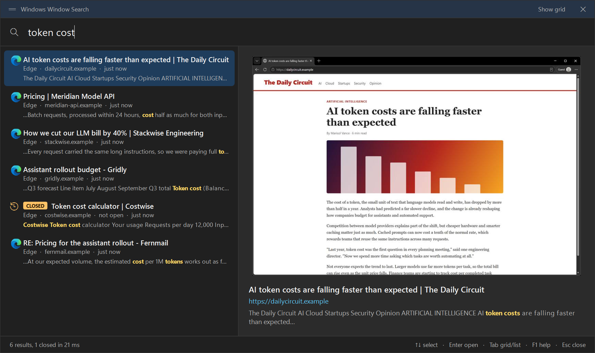
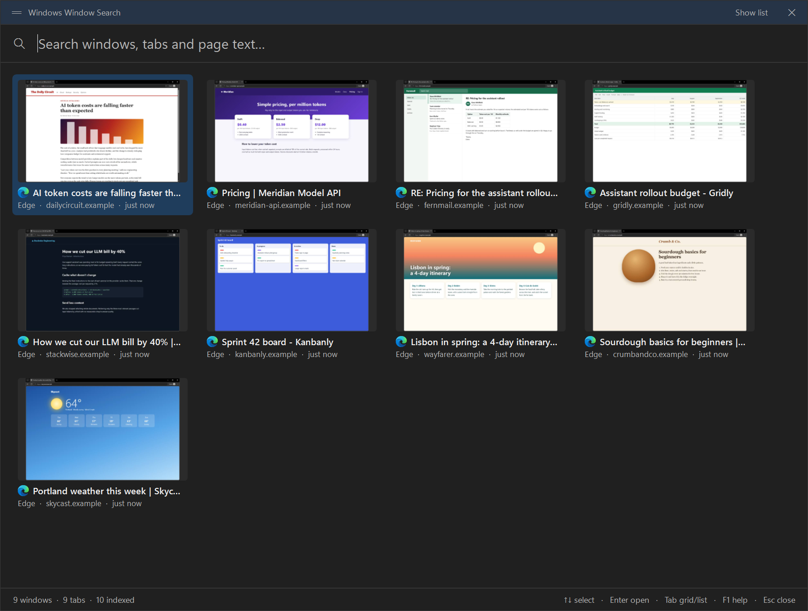
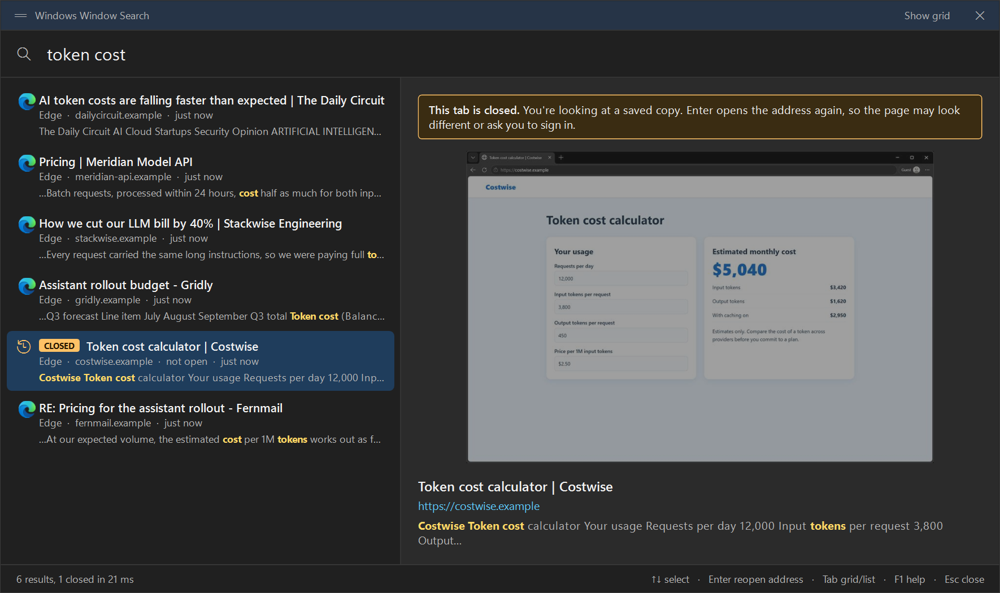
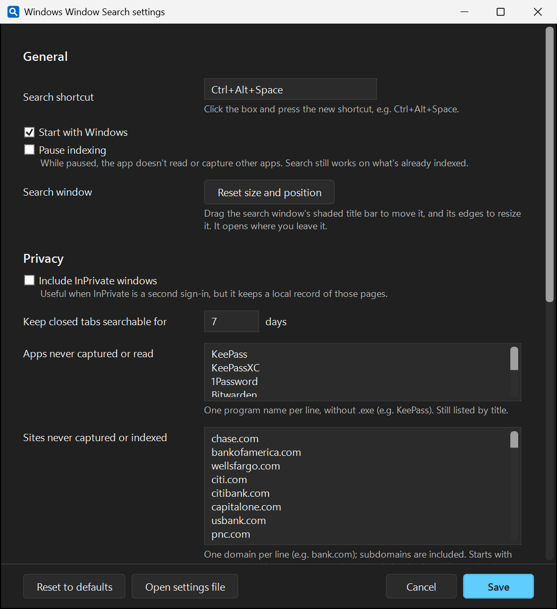

<p align="center">
  
</p>

<h1 align="center">Windows Window Search</h1>

<p align="center">
  <strong>Too many windows and tabs open? Type what you remember and jump straight to it.</strong>
</p>

<p align="center">
  Searches window titles, browser tabs and the text inside them, shows you a preview, and takes you there.<br>
  Everything stays on your PC, encrypted.
</p>

<p align="center">
  
  
  
  
</p>

<p align="center">
  <a href="https://github.com/OzAILabs/WindowsWindowSearch/releases/latest"><strong>Download</strong></a>
  &nbsp;·&nbsp; <a href="#what-it-does">What it does</a>
  &nbsp;·&nbsp; <a href="#get-started">Get started</a>
  &nbsp;·&nbsp; <a href="#your-privacy">Your privacy</a>
  &nbsp;·&nbsp; <a href="docs/DEVELOPMENT.md">Developer notes</a>
</p>

<p align="center">
  
</p>

<p align="center"><sub>All screenshots show the real app with made-up websites.</sub></p>

## Why it exists

You know you read it somewhere. It's in one of 40 tabs across five windows, and the tab title is cut off to "Pric…". Alt-Tab gives you a wall of tiny thumbnails, and browser tab search only covers one browser and can't look inside your other apps.

Press **Ctrl+Alt+Space**, type a word you remember from the page, and press **Enter**. You're there.

## What it does

<table>
  <tr>
    <td width="50%" valign="top">
      <h3>🔎 Searches inside, not just titles</h3>
      Finds words in the text of your windows and Edge tabs. When an app doesn't share its text, built-in Windows OCR reads it from a screenshot.
    </td>
    <td width="50%" valign="top">
      <h3>🖼️ Shows you before you switch</h3>
      Every result has a saved preview and a highlighted snippet, so you can tell the right page from five similar ones.
    </td>
  </tr>
  <tr>
    <td valign="top">
      <h3>⚡ Takes you straight there</h3>
      Enter brings up the window, restores it if it's minimized, and selects the exact tab. Results appear in milliseconds as you type.
    </td>
    <td valign="top">
      <h3>🧩 Needs no browser extension</h3>
      It reads Edge's tabs through Windows' own accessibility features. Nothing to install in your browser.
    </td>
  </tr>
</table>

### See everything at a glance

Press **Tab** or click **Show grid** for large previews of everything open. It's handy when you remember what a page *looked* like.

<p align="center">
  
</p>

### Find what you just closed

Closed tabs stay searchable for 7 days. They're clearly marked, because it's a saved copy: Enter opens the address again, and the page may have changed or ask you to sign in.

<p align="center">
  
</p>

## Get started

1. **[Download the latest MSI](https://github.com/OzAILabs/WindowsWindowSearch/releases/latest)** and run it. It needs administrator approval, and because it isn't code-signed, Windows SmartScreen may warn you first.
2. **Launch Windows Window Search.** It runs quietly in the system tray, behind a blue magnifying glass icon.
3. **Press Ctrl+Alt+Space** and start typing.

Requires 64-bit Windows 10 (version 2004 or later) or Windows 11. There's nothing else to install.

> **Shortcut not working?** Another app may be using it, such as Claude's Quick Entry. Choose a different one under tray icon → **Settings…**. If the tray icon is hidden, turn it on in Windows Settings under Personalization → Taskbar → Other system tray icons.

### Keyboard

| Key | What it does |
|---|---|
| <kbd>Ctrl</kbd> + <kbd>Alt</kbd> + <kbd>Space</kbd> | Open or close the search window |
| <kbd>↑</kbd> <kbd>↓</kbd> | Choose a result |
| <kbd>Enter</kbd> | Switch to it |
| <kbd>Tab</kbd> | Switch between list and grid |
| <kbd>F1</kbd> | Open the user guide |
| <kbd>Esc</kbd> | Close the search window |

## Your privacy

An app that reads your screen has to earn your trust, so here's exactly what it does.

- **Nothing leaves your PC.** The app makes no network connections. There's no account, cloud or telemetry.
- **Saved data is encrypted.** Saved text and previews use a key that Windows protects for your account, so the files are useless if copied to another PC or opened by another account.
- **Sensitive places are skipped.** Password fields, password managers and InPrivate windows are left alone, along with common banking, payment, tax, health and sign-in sites. You can edit the lists.
- **Old data goes away.** Text from closed apps is deleted right away, and closed tabs after 7 days. You can also wipe everything or pause indexing at any time.

<p align="center">
  
</p>

**What encryption can't do:** a program running as you while you're signed in can ask Windows for the same key this app uses. It protects your saved data from being copied elsewhere, not from malware already on your PC.

## Good to know

- **Tabs:** Edge only shares the text of the tab that's showing, so a tab becomes searchable by its text once you've viewed it. Until then it matches by title. **Scan tabs** reads the rest for you on demand.
- **Browsers:** tab support is built around Edge, and also recognizes Chrome, Brave, Vivaldi and Opera. Firefox appears as a single window.
- **Resources:** it used about 200 MB of memory and no measurable CPU when idle in testing.

## For developers

Written in C# with .NET 10 and WPF. Full-text search uses SQLite FTS5 in an encrypted database.

```powershell
dotnet build WindowSearcher.slnx
dotnet test tests/WindowSearcher.Tests
```

See the [developer notes](docs/DEVELOPMENT.md) for how it works, all settings, and how releases are built.

---

<p align="center">
  <a href="https://github.com/OzAILabs"></a><br>
  <sub>Made by <a href="https://github.com/OzAILabs">OzAILabs</a></sub>
</p>
